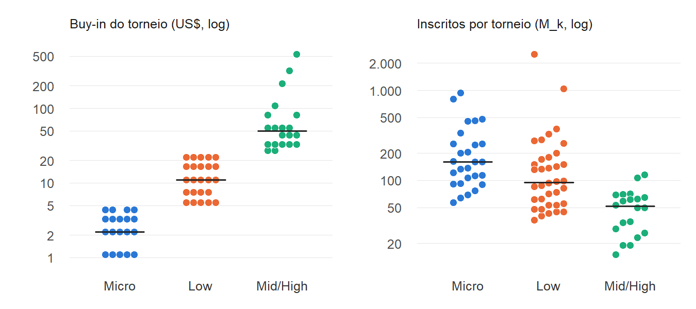
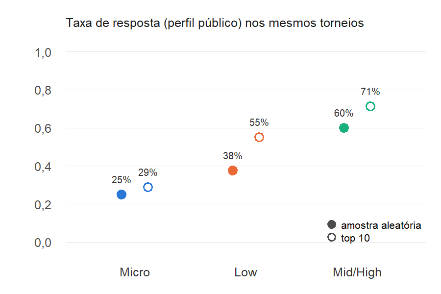
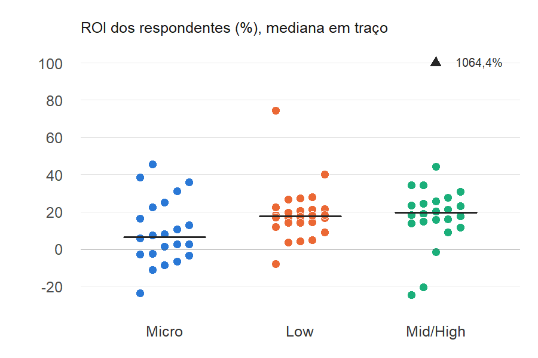

## Análise exploratória dos estratos de buy-in (coleta de campo)

**Objetivo:** fechar a ressalva de [`estratificacao_buyin.md`](estratificacao_buyin.md). Os 3 estratos foram escolhidos com o Kaggle, que é sintético e usa o buy-in *médio* do jogador. Aqui se olha o campo, onde o estrato é o buy-in do *torneio*: a moldura (83 torneios em 4 blocos), a não resposta e a distribuição do ROI e dos lucrativos em cada estrato.

**Reprodução:** `Rscript scripts/explorar_estratos.R`. Grava as tabelas em `data/processed/aed_estratos_*.csv` e as figuras em `docs/figuras/aed_estratos_*.png`. As funções estão em `R/exploracao_estratos.R`.

**Duas leituras, que não se misturam:**

- **Descritiva, sem peso:** média, quartis, decomposição da soma de quadrados e testes, calculados nos 72 respondentes como se fossem independentes. Serve para explorar. Os p-valores ignoram a conglomeração em torneios e blocos e são otimistas.
- **Inferencial:** a estimativa por estrato (domínio) usa o estimador de três estágios com os pesos do plano. Cada estrato, restrito aos blocos sorteados, é ele mesmo uma amostra em três estágios (blocos → torneios do estrato → jogadores). IC com gl = b − 1 = 3.

### 1. Moldura

| Estrato | Torneios ($N_h$) | Buy-in US\$ (mín – mediana – máx) | Inscrições ($\sum M_k$) | Mediana de $M_k$ | % dos torneios | % das inscrições |
|---|---|---|---|---|---|---|
| Micro | 27 | 1,10 – 2,20 – 4,40 | 6.374 | 160 | 32,5% | 42,1% |
| Low | 36 | 5,50 – 11,00 – 22,00 | 7.743 | 95 | 43,4% | 51,1% |
| Mid/High | 20 | 27,00 – 49,50 – 530,00 | 1.032 | 51,5 | 24,1% | 6,8% |
| Total | 83 | | 15.149 | | | |

- Os três estratos aparecem nos 4 blocos efetivos. As 12 células bloco × estrato têm de 3 a 11 torneios. A menor é bloco 30 × micro ($N_{jh} = 3$), que esgotou com os torneios extras (ADR-011).
- Os torneios Mid/High são pequenos, com mediana de 51,5 inscritos contra 160 no Micro. O estrato tem 24% dos torneios, mas só 6,8% das inscrições. Por isso pesa pouco na média geral.
- O Mid/High é heterogêneo no buy-in, de US\$ 27 a US\$ 530. Só 4 torneios têm buy-in ≥ US\$ 100 (109, 215, 320 e 530), e eles estão em apenas 2 dos 4 blocos (24 e 30). O estrato High (≥ US\$ 100) da alternativa com 5 estratos ficaria vazio nos blocos 5 e 8. Isso confirma no campo a inviabilidade apontada no §4 de `estratificacao_buyin.md`.

### 2. Não resposta

| Estrato | Consultados | Privados ou "Anônimo" | Taxa de não resposta |
|---|---|---|---|
| Micro | 60 | 38 | 63,3% |
| Low | 60 | 34 | 56,7% |
| Mid/High | 40 | 16 | 40,0% |
| Total | 160 | 88 | 55,0% |

A não resposta cai à medida que o buy-in sobe. O ADR-006 pede a taxa por estrato. O gradiente se repete no top 10 dos mesmos torneios, que fica fora do plano:

| Estrato | Taxa de resposta: amostra aleatória | Taxa de resposta: top 10 | ROI mediano: amostra | ROI mediano: top 10 | % lucrativos: amostra | % lucrativos: top 10 |
|---|---|---|---|---|---|---|
| Micro | 25,0% (10/40) | 28,8% (23/80) | 9,4% | 14,3% | 80% | 87% |
| Low | 37,5% (15/40) | 55,0% (44/80) | 20,5% | 16,1% | 100% | 95% |
| Mid/High | 60,0% (24/40) | 71,3% (57/80) | 19,5% | 17,2% | 88% | 88% |

*Só os 24 torneios originais, em que o top 10 foi consultado. Nos 8 torneios extras a resposta foi maior (23/40 = 57,5% contra 49/120 = 40,8% nos originais). Por isso as taxas da amostra nesta tabela são menores que as da tabela anterior.*

- **O estrato com mais não resposta é o que mais pesa.** O Micro responde por 63% do $\hat N$ de jogadores (seção 3) e tem só 37% de resposta. Se a não resposta depende do resultado, o viés se concentra nele.
- **A resposta parece ligada ao desempenho no torneio.** Nos 3 estratos, quem terminou no top 10 tem o perfil mais vezes público. Entre os que responderam, porém, o ROI do top 10 é parecido com o da amostra aleatória. Por esse indicador, não há sinal claro de que a resposta dependa do ROI de longo prazo dentro do estrato.
- **Mesmo assim, os respondentes parecem bons demais.** 85% deles têm ROI > 0, contra cerca de 20% de lucrativos no Kaggle, e é de se esperar que, com o rake, a maioria dos jogadores perca. Perfis públicos no SharkScope devem super-representar jogadores regulares e vencedores. A hipótese de não resposta aleatória dentro do torneio (ADR-006) dificilmente vale, e o viés de não resposta deve dominar o erro amostral (Thompson §14.5).

### 3. ROI e lucrativos por estrato

**Respondentes, sem peso:**

| Estrato | n | Média | Média aparada (10%) | DP | Mín | Q1 | Mediana | Q3 | Máx |
|---|---|---|---|---|---|---|---|---|---|
| Micro | 22 | 9,3 | 8,7 | 17,6 | −23,6 | −2,9 | 6,5 | 21,0 | 45,4 |
| Low | 26 | 18,9 | 17,3 | 14,7 | −7,9 | 14,1 | 17,6 | 21,3 | 74,5 |
| Mid/High | 24 | 60,9 | 19,9 | 214,3 | −24,7 | 14,6 | 19,5 | 26,2 | 1.064,4 |
| Total | 72 | 30,0 | 15,8 | 124,7 | −24,7 | 7,0 | 17,1 | 23,7 | 1.064,4 |

**Estimativas por estrato (domínio), por jogador distinto (peso 1/f_i), IC 95% com gl = 3:**

| Estrato | ROI médio (EP) | IC 95% | Sem o maior ROI | P(lucrativo), IC logit | P(lucrativo estrito), IC logit | % do $\hat N$ |
|---|---|---|---|---|---|---|
| Micro | 9,9 (6,8) | [−11,8; 31,7] | 9,9 | 0,80 [0,26; 0,98] | 0,65 [0,05; 0,98] | 63,4% |
| Low | 20,6 (2,7) | [12,0; 29,1] | 20,6 | 0,98 [0,48; 1,00] | 0,89 [0,25; 0,99] | 32,0% |
| Mid/High | 100,5 (80,4) | [−155,4; 356,3] | 8,3 [−10,9; 27,4] | 0,70 [0,50; 0,85] | 0,60 [0,29; 0,85] | 4,6% |
| Total | 17,5 (5,5) | [−0,04; 35,0] | 13,3 [−0,6; 27,1] | 0,85 [0,48; 0,97] | 0,72 [0,13; 0,98] | 100% |

- **Micro é o estrato mais fraco.** Tem a menor mediana (6,5%), é o único com Q1 negativo e tem a menor proporção de lucrativos entre os respondentes (68% sem peso, 0,80 com peso). Low e Mid/High têm medianas parecidas, de 17,6% e 19,5%.
- **Cauda do Mid/High.** Um jogador (MuoMadre, bloco 8, ROI 1.064,4% com lucro de −R\$ 105.115, valores conferidos no SharkScope em 23/10) leva 8,5% do peso do estrato e sozinho faz a estimativa do estrato passar de 8,3% para 100,5%. O ROI do SharkScope é a média do ROI por torneio, e o lucro é o total; por isso os sinais podem divergir. Como o Mid/High tem só 4,6% do $\hat N$, o efeito na média geral é menor, de 13,3% para 17,5%. A estratificação contém a cauda num estrato de peso pequeno. A média aparada e a mediana do Mid/High (≈ 20%) dão a escala típica do estrato.
- Com b = 4 blocos, os ICs por estrato são largos e se sobrepõem, inclusive para as proporções.

### 4. Quanto o estrato explica

Decomposição hierárquica da soma de quadrados nos respondentes, sem peso: estrato > bloco no estrato > torneio na célula > jogador no torneio.

| Componente | gl | ROI: % da SQ | ROI: QM | ROI sem o maior: % da SQ | ROI sem o maior: QM | Lucrativo: % da SQ | Lucrativo: QM |
|---|---|---|---|---|---|---|---|
| Entre estratos | 2 | 3,2% | 17.778 | 6,5% | 605 | 10,3% | 0,480 |
| Entre blocos (no estrato) | 9 | 9,3% | 11.466 | 8,1% | 168 | 3,2% | 0,033 |
| Entre torneios (na célula) | 17 | 17,3% | 11.216 | 24,5% | 268 | 29,3% | 0,160 |
| Dentro dos torneios | 43 (42) | 70,2% | 18.008 | 60,9% | 270 | 57,2% | 0,124 |

- **η² do estrato:** 3% a 6% no ROI e 10% em lucrativo. Com alocação proporcional, o EPA da estratificação fica perto de 1 − η², entre 0,90 e 0,97. O ganho é pequeno, mas ao contrário do Kaggle (correlação de 0,0006 entre ROI e buy-in, EPA ≈ 1) os estratos diferem no campo.
- **Testes descritivos no ROI:** Kruskal-Wallis χ² = 6,57 com 2 gl (p = 0,037); Spearman entre ROI e buy-in do torneio ρ = 0,36 (p = 0,002). Os dois tratam os 72 jogadores como independentes. A direção vem do Micro, abaixo dos outros dois estratos.
- **O torneio quase não agrupa o ROI.** Sem o maior ROI, o QM entre torneios (268) é igual ao QM dentro (270), o que dá $\rho_{int}$ ≈ 0. Os 24,5% da SQ "entre torneios" vêm dos 17 gl e não de um efeito do torneio. Em lucrativo, o QM entre torneios é um pouco maior que o QM dentro (0,160 contra 0,124), um agrupamento leve. O que alarga os ICs é o b = 4 (gl = 3), e não o efeito de conglomerado.

### Conclusões

1. **A ressalva se confirma só em parte.** No campo os estratos diferem: o Micro tem ROI e proporção de lucrativos menores. Mas o estrato explica pouco da variabilidade (η² ≤ 10%), e o ganho de precisão com a estratificação é modesto, como previsto com o Kaggle.
2. **A estratificação foi útil por outros motivos.** Ela garantiu os três níveis de buy-in em todos os blocos e isolou a cauda pesada do Mid/High num estrato com 4,6% do peso.
3. **3 estratos era a escolha viável.** O High (≥ US\$ 100) teria 4 torneios em 2 de 4 blocos.
4. **O risco principal é a não resposta, e ela varia por estrato.** A resposta é de 37% no Micro, que tem 63% do peso, e os respondentes são majoritariamente vencedores (85% com ROI > 0). As estimativas valem para jogadores com perfil público no SharkScope. A extrapolação para todos os jogadores depende de uma hipótese de não resposta aleatória que os dados não sustentam.
