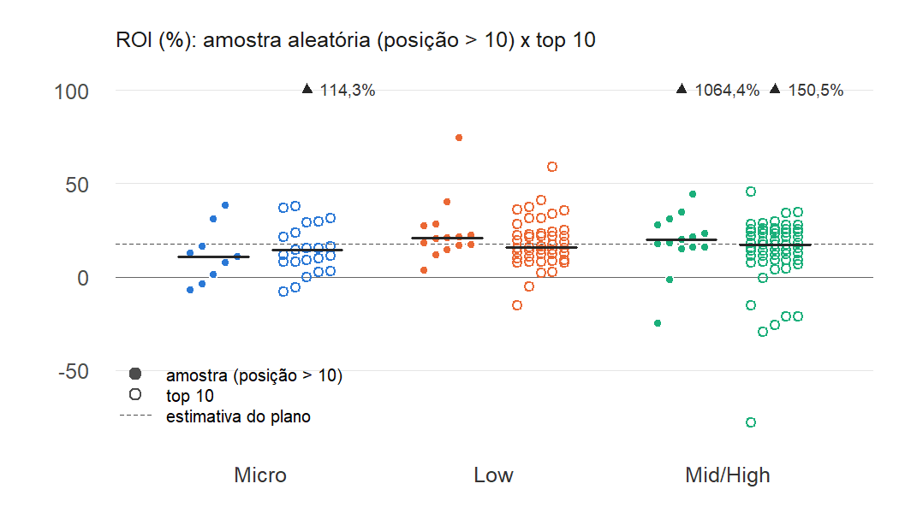
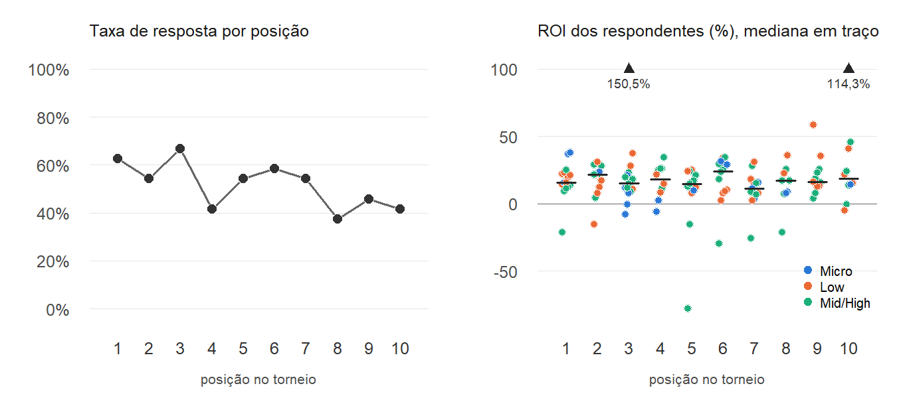

## Análise exploratória do top 10 e comparação com os outros resultados

**O que é o top 10:** os 10 primeiros colocados de cada um dos 24 torneios originais (os 8 torneios extras do ADR-011 ficaram de fora). Os nomes foram anotados em 20/10 e consultados no SharkScope de 05/11 a 10/11/2026, num levantamento completo, sem sorteio. O top 10 **fica fora do plano amostral**: é uma seleção intencional dos jogadores que foram melhor *naquele torneio* e não entra nos estimadores. Aqui ele serve para duas perguntas:

1. Quem termina no top 10 tem ROI de longo prazo maior que um jogador sorteado do mesmo torneio?
2. A não resposta depende do resultado no torneio? Esta pergunta testa a hipótese do ADR-006.

**Reprodução:** `Rscript scripts/explorar_top10.R`. Grava as tabelas em `data/processed/aed_top10_*.csv` e as figuras em `docs/figuras/aed_top10_*.png`. As funções estão em `R/exploracao_top10.R`. Tudo é sem peso, e os p-valores tratam os jogadores como independentes. O nickname é comparado sem o sufixo de re-entrada `[n]`.

**Grupos comparados, sempre nos mesmos 24 torneios:**

- **top 10:** posições 1 a 10.
- **amostra, posição > 10:** a amostra aleatória fora do top 10. As posições 1 a 10 sorteadas na amostra são o mesmo registro do top 10 (seção 4), e por isso ficam de fora: assim os grupos não se sobrepõem.

### 1. O top 10 ao lado dos outros resultados

| Fonte | Tipo | n | ROI médio | ROI mediano | % lucrativos (ROI > 0) |
|---|---|---|---|---|---|
| Kaggle (população sintética) | parâmetro | 45.000 | −31,9% | −34,0% | 19,4% |
| Campo: plano em três estágios | com peso (1/f_i) | 72 | 17,5% | — | 85,4% |
| Campo: amostra aleatória (32 torneios) | sem peso | 72 | 30,0% | 17,1% | 84,7% |
| Campo: amostra, posição > 10 (24 torneios) | sem peso | 38 | 46,5% | 18,2% | 89,5% |
| **Top 10 (24 torneios)** | sem peso | 124 | **17,3%** | **16,1%** | **90,3%** |

*A média da amostra (30,0% e 46,5%) é puxada por um único ROI de 1.064,4% (`aed_estratos.md`, §3). Sem ele, a média da amostra fora do top 10 cai para 19,0%; a média aparada é de 19,3%.*

- **O top 10 e a amostra aleatória dão quase o mesmo resultado:** ROI mediano de 16% a 18% e cerca de 85% a 90% de lucrativos. O ROI do top 10 também fica perto da estimativa do plano (17,5%).
- **Os dois grupos estão muito longe do Kaggle** (ROI de −32%, 19% de lucrativos). A diferença não vem de ter terminado bem no torneio, porque aparece igual nos dois grupos. Ela vem de quem tem perfil público no SharkScope (`aed_estratos.md`, §2). O Kaggle é sintético, mas a ordem de grandeza (a maioria perde, por causa do rake) é a esperada numa população real de jogadores.

### 2. Top 10 x amostra: o ROI não difere, a resposta sim

| | Top 10 | Amostra, posição > 10 | Teste (descritivo) |
|---|---|---|---|
| Consultados | 240 | 101 | |
| Taxa de resposta | 51,7% | 37,6% | Wilcoxon pareado por torneio: p = 0,040 (24 torneios) |
| Respondentes (jogadores distintos) | 124 (116) | 38 (37) | |
| ROI: Q1 – mediana – Q3 | 9,1 – 16,1 – 24,9 | 13,1 – 18,2 – 27,5 | Mann-Whitney: p = 0,32; pareado por torneio: p = 0,15 (20 torneios) |
| ROI médio aparado (10%) | 17,1% | 19,3% | |
| % lucrativos (ROI > 0) | 90,3% | 89,5% | Fisher: OR = 1,10, p = 1,00 |
| % lucrativos estritos (ROI > 0 e lucro > 0) | 82,3% | 73,7% | |
| Jogos por dia (mediana) | 12,3 | 11,4 | |
| Lucro (mediana, R\$) | 102.775 | 69.863 | |

**Por estrato:**

| Estrato | Taxa de resposta: top 10 | Taxa de resposta: amostra | ROI mediano: top 10 | ROI mediano: amostra | % lucrativos: top 10 | % lucrativos: amostra |
|---|---|---|---|---|---|---|
| Micro | 28,8% (23/80) | 23,1% (9/39) | 14,3% | 10,7% | 87% | 78% |
| Low | 55,0% (44/80) | 36,8% (14/38) | 16,1% | 20,8% | 95% | 100% |
| Mid/High | 71,3% (57/80) | 62,5% (15/24) | 17,2% | 20,1% | 88% | 87% |

- **Terminar no top 10 não indica ROI de longo prazo maior** entre os jogadores com perfil público. A mediana, os quartis e a proporção de lucrativos são parecidos, e nenhum teste acusa diferença. No Low e no Mid/High, a amostra fica até um pouco acima. Só no Micro o top 10 fica acima (14,3% contra 10,7%), mas a amostra tem só 9 respondentes nesse estrato. O resultado de um torneio isolado é dominado pela variância: é a tese "skill vs. variance" do próprio dataset do Kaggle.
- **Dentro do top 10, o ROI não depende da posição** (Spearman ρ = −0,02, p = 0,84), nem da posição relativa ao tamanho do torneio, posição/M_k (ρ = −0,05, p = 0,55).
- **Dentro do top 10, o ROI também não depende do estrato.** O estrato explica 0,3% da soma de quadrados, e o QM entre estratos (102) fica abaixo do QM dentro dos torneios (472). Na amostra aleatória o Micro ficava abaixo dos outros estratos (`aed_estratos.md`, §3). No top 10 essa diferença some: os que vão bem no Micro são jogadores tão bons quanto os dos outros estratos e jogam mais (média de 18,2 jogos por dia contra 12,2 na amostra do Micro).

### 3. A não resposta depende do resultado no torneio

| Posições | Consultados | Taxa de resposta | Anônimos |
|---|---|---|---|
| 1 – 3 | 72 | 61,1% (44) | 1 |
| 4 – 7 | 96 | 52,1% (50) | 6 |
| 8 – 10 | 72 | 41,7% (30) | 8 |
| Amostra, posição > 10 | 101 | 37,6% (38) | — |

- **A resposta cai com a posição:** 61% nas 3 primeiras posições, 42% nas posições 8 a 10 e 38% fora do top 10. Em 15 dos 24 torneios a taxa do top 10 supera a da amostra, em 3 empata e em 6 fica abaixo (Wilcoxon pareado, p = 0,04). O padrão se repete nos 3 estratos.
- **Isso contraria a hipótese do ADR-006** de não resposta aleatória dentro do torneio: a chance de o perfil ser público cresce com o resultado no próprio torneio.
- **O efeito no ROI parece pequeno, porém.** Entre os respondentes, o ROI não depende da posição (seção 2). Ou seja, o resultado no torneio muda *quem* responde, mas não o ROI de longo prazo de quem responde. O viés que de fato preocupa é outro: o ROI dos perfis públicos (≈ 90% lucrativos) contra o de todos os jogadores (seção 1). Esse viés é o mesmo nos dois grupos e não se corrige com o top 10.

### 4. Consistência da medida: 19 registros consultados duas vezes

22 posições sorteadas na amostra aleatória caíram entre as 10 primeiras, quase todas em torneios com menos de 100 inscritos. Dessas, 19 estão em torneios originais e foram consultadas de novo no top 10, de 14 a 18 dias depois.

| | Registros |
|---|---|
| Mesmo jogador (nickname sem o sufixo `[n]`) | 19 de 19 |
| Mesmo status de resposta nas duas consultas | 19 de 19 (11 públicos, 8 privados) |
| Diferença de ROI entre as consultas (públicos) | de −0,5 a +0,2 ponto percentual; média absoluta de 0,15 |

- **A medida é estável.** O ROI do SharkScope (janela de 1 ano) quase não muda em duas semanas, e o status privado/público não oscila. A não resposta é um atributo do perfil, e não uma falha da consulta.
- **Jogadores regulares reaparecem.** Os 124 respondentes do top 10 são 116 jogadores distintos. Além dos 19 registros repetidos, 6 jogadores aparecem no top 10 de um torneio e na amostra aleatória de outro (comistus, CrazySezya, JusuBoi, LuckAnd, Mind_ze e whitesugar96). Isso ilustra a multiplicidade que o peso 1/f_i corrige (ADR-009): quem joga mais tem mais chance de ser sorteado.

### Conclusões

1. **O top 10 confirma a estimativa do campo.** ROI mediano de 16% e 90% de lucrativos, contra uma estimativa do plano de 17,5% e 85%. Terminar bem num torneio não separa jogadores de ROI maior.
2. **A não resposta não é aleatória dentro do torneio:** cresce com o resultado no torneio (61% de resposta no top 3, 38% fora do top 10). Mas, entre os respondentes, isso não se traduz em ROI diferente.
3. **O viés dominante continua sendo o perfil público.** Amostra e top 10 têm ~90% de lucrativos, contra ~20% no Kaggle. As estimativas do campo valem para jogadores com perfil público no SharkScope.
4. **A medida é confiável:** 19 de 19 reconsultas com o mesmo status e ROI a menos de 0,5 ponto de distância.
