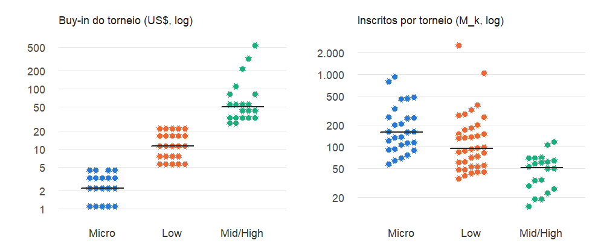
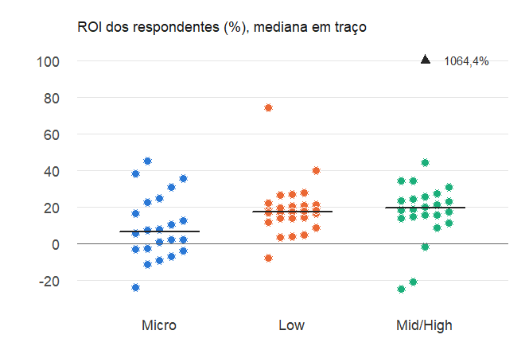
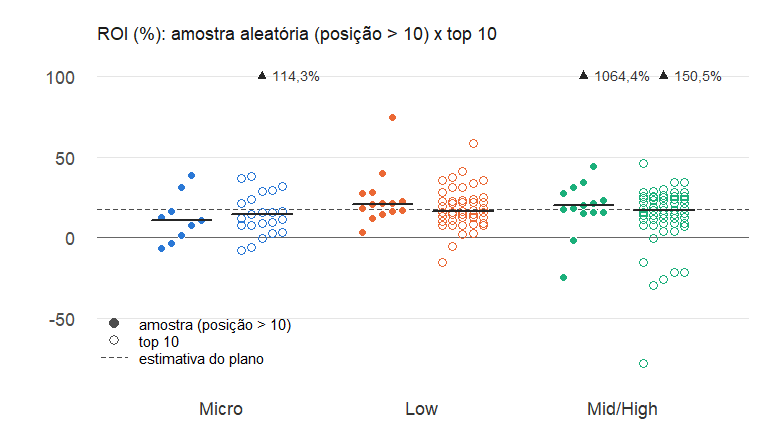
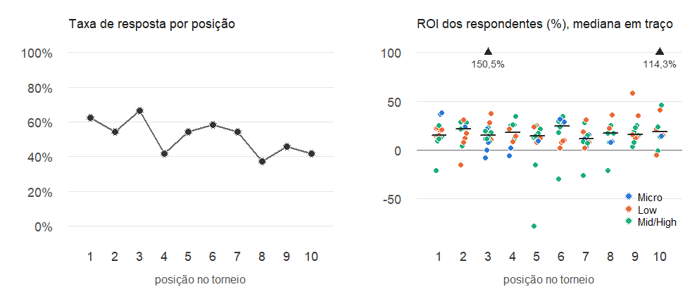

# Comparação de Planos Amostrais no Poker Online

**AAS e AAS estratificada (Kaggle) vs. amostragem estratificada em três
estágios (SharkScope)**

Arthur Agostinho Furlan Teixeira (RA 164363) · ME430 — Técnicas de
Amostragem · Estatística, Unicamp · 2º semestre de 2026

> Versão em Markdown gerada a partir de `docs/relatorio.Rmd`. Para
> atualizar:
> `Rscript -e 'rmarkdown::render("docs/relatorio.Rmd", output_format = "all")'`.

# Resumo

Não existe uma lista dos jogadores de poker online, e por isso não é
possível sortear jogadores diretamente. Este trabalho compara duas
formas de contornar a falta de moldura. A primeira é a amostragem direta
de elementos (AAS e AAS estratificada), possível só quando há uma lista:
ela foi simulada por Monte Carlo num dataset do Kaggle, tratado como
população conhecida. A segunda é uma **amostragem estratificada em três
estágios** aplicada em campo no SharkScope, em que a única moldura é o
tempo: sorteiam-se blocos de 2 h, depois torneios dentro dos blocos
(estratificados por buy-in) e, por fim, jogadores dentro dos torneios.

Entre os jogadores com perfil público no SharkScope que jogaram MTTs do
PokerStars de 17/10/2026 20:00 a 21/10/2026 00:00:

| Parâmetro (por jogador distinto) | Estimativa | EP linearizado | IC 95% | EP jackknife | IC 95% (jackknife) |
|----|---:|---:|----|---:|----|
| ROI médio (%) | 17,47 | 5,50 | \[-0,04; 34,98\] | 5,21 | \[0,89; 34,05\] |
| Lucrativos (ROI \> 0) | 0,854 | 0,073 | \[0,476; 0,974\] | 0,116 | \[0,233; 0,991\] |
| ROI \> 0 e lucro \> 0 | 0,723 | 0,181 | \[0,128; 0,979\] | 0,291 | \[0,025; 0,996\] |

IC t com 3 graus de liberdade para o ROI e IC logit para as proporções.

- **As estimativas valem para perfis públicos.** A não resposta foi de
  55%, e quem mantém o perfil aberto tende a ser mais regular e mais
  vencedor. No Kaggle, só 19% dos jogadores são lucrativos.
- **Os intervalos são largos e ainda otimistas.** Só 4 blocos puderam
  ser usados, e numa simulação do mesmo plano o erro-padrão linearizado
  captou cerca de metade da variância real. O jackknife de blocos acerta
  a variância em média, mas nenhum dos dois leva a cobertura a 95%. O IC
  do ROI médio encosta em zero.
- **O plano em três estágios é de 6 a 12 vezes menos eficiente que uma
  AAS de mesmo tamanho**, sobretudo pela desigualdade dos pesos. É o
  preço de não ter moldura de jogadores.
- **Estratificar por buy-in não ajudou no Kaggle** (efeito do
  planejamento ≈ 1), porque o ROI médio é o mesmo nas três faixas.

# 1. Introdução

O ROI (*return on investment*) de um jogador de torneios é o lucro
líquido dividido pelo total pago em inscrições, em %. Este trabalho
estima dois parâmetros da população de jogadores de MTTs (torneios
multimesa) do PokerStars:

- $`\bar Y`$, o **ROI médio por jogador distinto**;
- $`P`$, a **proporção de jogadores lucrativos**, em duas versões: ROI
  \> 0 (a mesma definição do Kaggle) e ROI \> 0 com lucro \> 0.

O desafio é amostral, não computacional: não há lista de jogadores para
sortear. As perguntas do projeto são:

1.  Qual o ROI médio por jogador e a proporção de lucrativos, com IC de
    95%?
2.  Quanto da variância vem da variação entre blocos, entre torneios e
    dentro dos torneios?
3.  Qual o efeito do planejamento (EPA) do plano em três estágios?
4.  No Kaggle, quanto a estratificação ganha em relação à AAS?
5.  Qual a taxa de não resposta e qual o seu possível impacto?

# 2. Populações e planos amostrais

## 2.1 População conhecida: o dataset do Kaggle

O dataset *Poker Tournament Survival* (Nefedov, Kaggle) tem 45.000
jogadores **sintéticos**, um por linha, com o histórico agregado de 10 a
1.567 torneios. As variáveis usadas são o ROI realizado, o indicador de
lucrativo e o buy-in médio. Não há torneio nem horário. Como a população
inteira é conhecida (ROI médio de −31,88% e 19,39% de lucrativos), cada
plano pode ser sorteado milhares de vezes e avaliado contra o valor
verdadeiro.

Planos simulados, com 5.000 réplicas cada:

- **AAS** sem reposição;
- **AAS estratificada** pelas mesmas três faixas de buy-in do campo, com
  alocação proporcional ($`n_h \propto N_h`$) e de Neyman
  ($`n_h \propto N_h S_h`$, com os $`S_h`$ verdadeiros);
- como referência didática, AAS estratificada por quartis de `skill`,
  uma variável latente que não existe em dados reais.

As duas alocações são arredondadas pelos maiores restos, com mínimo de 2
por estrato, de modo que $`\sum n_h = n`$ e a comparação com a AAS é de
mesmo tamanho. Os tamanhos são $`n = 120`$ (o planejado no campo) e
$`n = 67`$ (o que de fato entrou na estimação de campo).

## 2.2 Campo: amostragem estratificada em três estágios

A população de campo é a das **inscrições** (pares jogador × torneio) em
MTTs regulares do PokerStars com buy-in de US\$ 1,00 ou mais e início
entre 17/10/2026 20:00 e 21/10/2026 00:00 (horário de Brasília, 76 h).
Ficam de fora freerolls, Spin & Go, Sit & Go, satélites e cash game. ROI
e lucro de cada jogador são os do SharkScope no PokerStars, na janela
fixa de 01/10/2025 a 30/09/2026.

| Estágio | Unidade | População | Amostra planejada |
|----|----|----|----|
| 1º (UPA) | Bloco de 2 h | $`B = 38`$ | $`b = 6`$ |
| Estratificação, dentro do bloco | Faixa de buy-in: Micro (US\$ 1–4,99), Low (5–24,99), Mid/High (≥ 25) | $`H = 3`$ | — |
| 2º (USA) | Torneio | $`N_{jh}`$ por célula (bloco × estrato) | $`n_{jh} = 2`$ |
| 3º (UTA) | Jogador (posição na lista de resultados) | $`M_k`$ (total de entradas) | $`m_k = 5`$ |

O estágio temporal resolve o problema de moldura: não há lista de todos
os torneios do período, mas a lista dos 38 blocos é trivial, e só os
torneios dos blocos sorteados precisam ser listados, como na amostragem
por áreas (Cochran, 1977, cap. 10–11). A estratificação por buy-in é
feita dentro de cada bloco e não é um estágio. O 3º estágio sorteia
**posições** na lista de resultados do torneio (1 = campeão), que tem
ordem fixa, em vez de transcrever a lista de inscritos.

Todos os sorteios são AAS sem reposição com a semente 164363. Os
torneios dos 4 blocos efetivos formam a moldura do 2º estágio:

| Bloco | Micro | Low | Mid/High | Total |
|:------|------:|----:|---------:|------:|
| 5     |     7 |   8 |        3 |    18 |
| 8     |     8 |   8 |        5 |    21 |
| 24    |     9 |  11 |        7 |    27 |
| 30    |     3 |   9 |        5 |    17 |

Torneios elegíveis por bloco e estrato (N_jh)

Os blocos efetivos são domingo 04–06 h (bloco 5) e 10–12 h (bloco 8),
segunda 18–20 h (bloco 24) e terça 06–08 h (bloco 30).

## 2.3 O que aconteceu na execução

- **Dois blocos perdidos.** Os blocos 34 e 36 (terça, 14–16 h e 18–20 h)
  saíram do alcance da busca do SharkScope antes de serem listados.
  Foram tratados como não resposta de UPA, sem substituição, porque
  trocar UPAs por escolha tira a base probabilística do 1º estágio:
  $`b = 4`$ e peso $`B/b = 9{,}5`$. A hipótese é que a perda não tem
  relação com o ROI, já que veio do acesso à fonte.
- **Não resposta de 55%.** Perfis privados e jogadores “Anônimo” não
  podem ser consultados. Em cada torneio, $`m_k`$ passa a ser o número
  de respondentes, sob a hipótese de não resposta aleatória dentro do
  torneio. Para manter ao menos 2 torneios com 2 respondentes por
  célula, mínimo necessário para estimar a variância, células abaixo do
  mínimo receberam o próximo torneio da mesma permutação (8 torneios
  extras). Os $`n`$ primeiros elementos de uma permutação aleatória são
  uma AAS de tamanho $`n`$, então os extras não alteram o caráter
  aleatório do sorteio. Torneios com 0 ou 1 respondente ficaram fora da
  estimação.
- **Colisão nas sementes derivadas.** Cada torneio recebeu uma semente
  derivada da principal, mas a função usada gera valores repetidos para
  identificadores numéricos: 2 pares dos 32 torneios sorteados tiveram a
  mesma semente, e um par recebeu as mesmas 5 posições. Cada torneio
  continua sendo uma AAS de posições, mas os sorteios do 3º estágio não
  são todos independentes entre torneios, como a fórmula de variância
  supõe. O efeito numérico é pequeno (um dos dois torneios ficou fora da
  estimação), e o sorteio não pode ser refeito depois da coleta.

|                          | Sorteado |                     Usado na estimação |
|:-------------------------|---------:|---------------------------------------:|
| Blocos                   |        6 |                                      4 |
| Torneios                 |       32 |                      24 (2 por célula) |
| Posições consultadas     |      160 |                                      — |
| Respondentes             |        — | 67 inscrições (66 jogadores distintos) |
| Respondentes por torneio |        5 |                                   2,79 |

Amostra efetiva

# 3. Estimadores

## 3.1 Pesos e média por jogador distinto

Como cada estágio é uma AAS sem reposição, a probabilidade de inclusão
de uma inscrição é o produto das probabilidades de cada estágio, e o
peso é o inverso:

``` math
w = \frac{B}{b}\cdot\frac{N_{jh}}{n_{jh}}\cdot\frac{M_k}{m_k},
```

calculado por célula (bloco × estrato), e não com um único $`N_h/n_h`$
por estrato somando blocos diferentes.

O plano sorteia inscrições, então quem joga mais torneios tem mais
chance de entrar. Um jogador com $`f_i`$ inscrições no período aparece
$`f_i`$ vezes na população; atribuindo $`y_i/f_i`$ a cada uma delas, a
soma sobre as inscrições é a soma sobre os jogadores. O total de
jogadores também é desconhecido, e a média é o **estimador razão**
(Thompson, 2012, p. 175):

``` math
\hat{\bar Y} = \hat R = \frac{\sum w\,y_i/f_i}{\sum w/f_i} = \frac{\hat Y}{\hat N}.
```

$`f_i`$ é aproximado por `n_jogos_dia` × 76/24, com mínimo 1, em que
`n_jogos_dia` é a média de jogos por dia que o SharkScope mostra para a
janela de 12 meses. A versão **por inscrição** usa $`f_i = 1`$ e serve
de sensibilidade. As proporções usam o mesmo estimador, com $`y_i`$
igual a uma indicadora.

## 3.2 Variância

A variância do total soma um termo por estágio, cada um com sua correção
para população finita (Cochran, 1977, cap. 11; Thompson, 2012, eq.
13.6–13.8):

``` math
\widehat{\mathrm{Var}}(\hat Y) = B^2\Bigl(1-\tfrac{b}{B}\Bigr)\frac{s_u^2}{b} + \frac{B}{b}\sum_{j=1}^{b}\sum_{h}\Biggl[N_{jh}^2\Bigl(1-\tfrac{n_{jh}}{N_{jh}}\Bigr)\frac{s_{1jh}^2}{n_{jh}} + \frac{N_{jh}}{n_{jh}}\sum_{k} M_k^2\Bigl(1-\tfrac{m_k}{M_k}\Bigr)\frac{s_{2k}^2}{m_k}\Biggr],
```

em que $`s_u^2`$ é a variância amostral dos totais estimados
$`\hat Y_j`$ dos blocos, $`s_{1jh}^2`$ a dos totais estimados
$`\hat T_k = M_k \bar y_k`$ dos torneios da célula, e $`s_{2k}^2`$ a de
$`y`$ entre os respondentes do torneio. O fator $`M_k^2`$ é necessário
porque os torneios têm tamanhos diferentes. A implementação reproduz os
Exemplos 1 e 2 de Thompson (2012, §13.1).

Para a razão, a variância é aproximada por **linearização de Taylor**:
aplica-se a fórmula acima à variável $`z_i = (y_i - \hat R)/f_i`$ e
divide-se por $`\hat N^2`$ (Lohr, 2022, cap. 9). Como alternativa que
não depende da linearização, reporta-se ao lado o **jackknife de
blocos** (JK1), que recalcula a razão retirando um bloco por vez
(Wolter, 2007, cap. 4):

``` math
\hat v_{JK} = \frac{b-1}{b}\sum_{j=1}^{b}\bigl(\hat R_{(j)} - \hat R\bigr)^2.
```

## 3.3 Intervalos de confiança

Com $`b/B`$ pequeno, a variância é estimada essencialmente a partir dos
$`b`$ totais de bloco, então os graus de liberdade vêm do número de
UPAs: $`\hat R \pm t_{b-1;\,0{,}975}\,\mathrm{EP}`$, com
$`t_{3;\,0{,}975} = 3{,}18`$. Com $`\hat P`$ perto de 1 e 3 graus de
liberdade, o intervalo de Wald passa de 1 (para os lucrativos, \[0,622;
1,086\]). Por isso, para as proporções, o intervalo principal é o
**logit**: o IC t é calculado em $`\ell = \log\{\hat P/(1-\hat P)\}`$,
com $`\mathrm{EP}_\ell = \mathrm{EP}/\{\hat P(1-\hat P)\}`$ pelo método
delta, e volta para a escala de proporção. Ele é assimétrico e fica
sempre em (0, 1), como `svyciprop(method = "logit")` do pacote `survey`
(Lumley, 2010).

## 3.4 Componentes de variância

A pergunta 2 pede quanto da variância vem de cada estágio. As duas
parcelas da fórmula da §3.2 **não** respondem a isso: a primeira usa os
totais *estimados* $`\hat Y_j`$, e $`E[s_u^2] = S_u^2 + \bar V`$, em que
$`S_u^2`$ é a variância dos totais verdadeiros e $`\bar V`$ é a média
das variâncias dentro dos blocos. O primeiro termo já carrega, portanto,
a variação de dentro. Os estimadores não viesados dos componentes
descontam, em cada nível, a parte que vem do nível de baixo. Com
$`\bar v`$ igual à média dos $`\widehat{\mathrm{Var}}(\hat Y_j)`$ e
$`\bar w_{jh}`$ igual à média, na célula, de
$`M_k^2(1-m_k/M_k)s_{2k}^2/m_k`$:

``` math
\underbrace{B^2\Bigl(1-\tfrac{b}{B}\Bigr)\frac{s_u^2-\bar v}{b}}_{\text{entre blocos}} + \underbrace{\Bigl(\tfrac{B}{b}\Bigr)^{2}\sum_{j,h} N_{jh}^2\Bigl(1-\tfrac{n_{jh}}{N_{jh}}\Bigr)\frac{s_{1jh}^2-\bar w_{jh}}{n_{jh}}}_{\text{entre torneios}} + \underbrace{\Bigl(\tfrac{B}{b}\Bigr)^{2}\sum_{j,h} N_{jh}^2\,\frac{\bar w_{jh}}{n_{jh}}}_{\text{dentro dos torneios}}.
```

As três parcelas somam exatamente a variância da §3.2. Um componente
estimado negativo se lê como zero.

## 3.5 Efeito do planejamento

``` math
\text{EPA} = \frac{\widehat{\mathrm{Var}}(\hat R)}{\bigl(1 - n/\hat N\bigr)\, s_y^2/n},
```

com $`s_y^2`$ ponderada pelos pesos finais e estimada **na própria
amostra de campo**, nunca com a variância do Kaggle, que é outra
população (Bolfarine e Bussab, 2005, §3.4). O EPA é separado na parte
que vem só da desigualdade dos pesos,
$`1 + \mathrm{CV}^2(w) = n\sum w^2/(\sum w)^2`$, e no resto (Kish,
1992); $`n/(1 + \mathrm{CV}^2(w))`$ é o tamanho efetivo de amostra de
Kish. Nas simulações, o EPA empírico é
$`\mathrm{Var}_{MC}(\text{plano})/\mathrm{Var}_{MC}(\text{AAS de mesmo } n)`$.

# 4. Simulações no Kaggle

## 4.1 Os estratos de buy-in na população

| Estrato  | Jogadores | % dos jogadores | ROI médio (%) | DP do ROI | Lucrativos |
|:---------|----------:|----------------:|--------------:|----------:|-----------:|
| Micro    |     1.060 |            2,4% |         -31,9 |      43,1 |      0,202 |
| Low      |    14.652 |           32,6% |         -32,4 |      45,6 |      0,189 |
| Mid/High |    29.288 |           65,1% |         -31,6 |      46,2 |      0,196 |

Estratos de buy-in no Kaggle (buy-in médio do jogador)

O ROI médio e a proporção de lucrativos são praticamente iguais nas três
faixas, e a correlação entre ROI e buy-in médio é de 0,0006. A
estratificação só reduz a variância quando as médias dos estratos
diferem, então não se espera ganho. Mesmo assim, o campo usa 3 estratos,
e não 5, por três razões: com 5 estratos o efeito do planejamento também
fica em torno de 1 (1,00 no ROI e 1,01 na proporção, com $`n = 60`$);
mais estratos dividem o mesmo orçamento em células menores e deixam a
variância de cada uma com menos graus de liberdade; e torneios com
buy-in ≥ US\$ 100 são raros demais para formar um estrato (só 4 na
moldura de campo, em 2 dos 4 blocos).

Ressalva: no Kaggle, o estrato é definido pelo buy-in *médio* do
jogador; no campo, pelo buy-in do *torneio*.

## 4.2 AAS e AAS estratificada

| Plano | n | Viés | EP real | EP estimado | Cobertura | EPA |
|:---|---:|---:|---:|---:|---:|---:|
| AAS | 120 | -0,008 | 4,198 | 4,190 | 94,6% | 1,00 |
| Estratificada, proporcional (buy-in) | 120 | -0,041 | 4,196 | 4,189 | 94,9% | 1,00 |
| Estratificada, Neyman (buy-in) | 120 | -0,019 | 4,166 | 4,182 | 94,6% | 0,98 |
| Estratificada, proporcional (skill) | 120 | -0,031 | 4,064 | 4,079 | 94,8% | 0,96 |
| Estratificada, Neyman (skill) | 120 | -0,057 | 4,067 | 4,066 | 94,9% | 0,96 |
| AAS | 67 | -0,115 | 5,635 | 5,587 | 94,3% | 1,00 |
| Estratificada, proporcional (buy-in) | 67 | 0,023 | 5,697 | 5,619 | 94,4% | 1,02 |
| Estratificada, Neyman (buy-in) | 67 | -0,004 | 5,608 | 5,597 | 94,5% | 0,99 |
| Estratificada, proporcional (skill) | 67 | -0,032 | 5,540 | 5,492 | 94,7% | 0,96 |
| Estratificada, Neyman (skill) | 67 | -0,036 | 5,468 | 5,458 | 95,0% | 0,94 |

Monte Carlo no Kaggle (5.000 réplicas): ROI médio (%)

| Plano | n | Viés | EP real | EP estimado | Cobertura | EPA |
|:---|---:|---:|---:|---:|---:|---:|
| AAS | 120 | 0,0001 | 0,0358 | 0,0361 | 94,9% | 1,00 |
| Estratificada, proporcional (buy-in) | 120 | -0,0003 | 0,0359 | 0,0360 | 95,5% | 1,00 |
| Estratificada, Neyman (buy-in) | 120 | 0,0002 | 0,0361 | 0,0361 | 95,3% | 1,01 |
| Estratificada, proporcional (skill) | 120 | 0,0008 | 0,0353 | 0,0352 | 94,7% | 0,96 |
| Estratificada, Neyman (skill) | 120 | -0,0007 | 0,0346 | 0,0346 | 94,2% | 0,92 |
| AAS | 67 | -0,0003 | 0,0481 | 0,0482 | 95,0% | 1,00 |
| Estratificada, proporcional (buy-in) | 67 | 0,0002 | 0,0487 | 0,0483 | 94,5% | 1,02 |
| Estratificada, Neyman (buy-in) | 67 | 0,0007 | 0,0487 | 0,0484 | 94,9% | 1,02 |
| Estratificada, proporcional (skill) | 67 | -0,0006 | 0,0477 | 0,0472 | 95,0% | 0,98 |
| Estratificada, Neyman (skill) | 67 | 0,0001 | 0,0465 | 0,0464 | 94,1% | 0,93 |

Monte Carlo no Kaggle (5.000 réplicas): Lucrativos (ROI \> 0)

“EP real” é o desvio-padrão das 5.000 estimativas; “EP estimado” é a
raiz da média das variâncias estimadas; “EPA” é a variância de Monte
Carlo do plano dividida pela da AAS de mesmo $`n`$.

- **Os três planos são confiáveis.** O viés é desprezível, o EP estimado
  acompanha o EP real e a cobertura fica entre 94% e 96%.
- **Estratificar por buy-in não traz ganho.** O EPA fica entre 0,98 e
  1,02, dentro do ruído de Monte Carlo (com 5.000 réplicas, a razão de
  duas variâncias tem EP de cerca de 0,03). A alocação de Neyman também
  não ajuda, porque os desvios-padrão dos estratos são parecidos.
- **Por `skill`, que se associa ao ROI (correlação de 0,23), o ganho é
  pequeno:** EPA de 0,92 a 0,98, próximo de $`1 - 0{,}23^2`$. O problema
  não está no método, mas na falta de associação entre buy-in e ROI.
- **A não resposta custou cerca de 34% de EP.** Passar de $`n = 120`$
  para $`n = 67`$ multiplica o EP da AAS por $`\sqrt{120/67} = 1{,}34`$.
  Esse é só o custo em variância; o viés de não resposta não aparece na
  simulação.

## 4.3 O plano de campo numa população sintética

O plano em três estágios não pode ser sorteado diretamente no Kaggle,
que não tem torneios. Para avaliá-lo, montou-se uma população sintética
com a estrutura do campo:

- 38 blocos; em cada bloco e estrato, $`N_{jh}`$ é sorteado entre os
  valores observados nos 4 blocos do SharkScope, e o $`M_k`$ de cada
  torneio, entre os $`M_k`$ observados no estrato;
- os lugares de cada torneio são preenchidos por sorteio sem reposição
  entre os jogadores do Kaggle do mesmo estrato, com probabilidade
  proporcional ao número de torneios jogados. Um jogador pode estar em
  vários torneios, e $`f_i`$ é a contagem exata;
- a população resultante tem 800 torneios, 151.948 inscrições e 21.793
  jogadores distintos, com ROI médio por jogador de −33,96% e 16,9% de
  lucrativos.

Os sorteios e os estimadores são exatamente os do campo. Limitação: os
torneios são preenchidos ao acaso dentro do estrato, então não há
correlação intraclasse nem efeito de horário; as diferenças entre blocos
vêm só de $`N_{jh}`$ e $`M_k`$.

| Parâmetro | b | Viés | EP real | EP linearizado | Var. lin. / real | Com N verdadeiro | JK1 / real |
|:---|---:|---:|---:|---:|---:|---:|---:|
| ROI médio (%) | 4 | -0,071 | 9,60 | 6,82 | 0,50 | 0,82 | 0,95 |
| ROI médio (%) | 6 | -0,122 | 8,82 | 6,35 | 0,52 | 0,82 | 1,00 |
| ROI médio (%) | 12 | -0,201 | 7,38 | 5,78 | 0,61 | 0,88 | 1,01 |
| Lucrativos (ROI \> 0) | 4 | -0,0022 | 0,086 | 0,061 | 0,50 | 0,79 | 0,94 |
| Lucrativos (ROI \> 0) | 6 | -0,0022 | 0,078 | 0,057 | 0,53 | 0,84 | 0,99 |
| Lucrativos (ROI \> 0) | 12 | -0,0016 | 0,064 | 0,051 | 0,64 | 0,90 | 1,02 |

Plano em três estágios na população sintética, por jogador (5.000
réplicas): precisão

| Parâmetro | b | Cobertura Wald | Cobertura logit | Cobertura JK1 | EPA empírico |
|:---|---:|---:|---:|---:|---:|
| ROI médio (%) | 4 | 93,3% | — | 94,0% | 6,8 |
| ROI médio (%) | 6 | 92,4% | — | 93,1% | 8,6 |
| ROI médio (%) | 12 | 92,0% | — | 92,9% | 12,0 |
| Lucrativos (ROI \> 0) | 4 | 89,8% | 94,6% | 90,8% | 6,3 |
| Lucrativos (ROI \> 0) | 6 | 88,0% | 93,1% | 90,2% | 7,8 |
| Lucrativos (ROI \> 0) | 12 | 87,1% | 92,2% | 89,4% | 10,7 |

Plano em três estágios na população sintética, por jogador: cobertura do
IC de 95% e EPA

1.  **O estimador pontual é praticamente não viesado**, incluindo o peso
    de multiplicidade $`1/f_i`$.
2.  **O EP linearizado é otimista: capta cerca de metade da variância
    com $`b = 4`$.** As fórmulas por estágio estão certas: para os
    totais, que não dependem de linearização, a variância estimada bate
    com a real (razão entre 0,97 e 1,05). O déficit está na razão.
    Dividindo pelo $`N`$ verdadeiro em vez de $`\hat N`$, a razão sobe
    para cerca de 0,8: a maior parte do problema vem de dividir por
    $`\hat N^2`$, que tem coeficiente de variação de cerca de 50% com 4
    blocos. O jackknife de blocos fica perto de 1.
3.  **Nem o jackknife leva a cobertura a 95%** com poucos blocos: a
    variância estimada tem $`b - 1`$ graus de liberdade e $`\hat R`$ é
    assimétrico. Nas proporções, o IC logit recupera boa parte da
    cobertura.
4.  **O plano é de 6 a 12 vezes menos eficiente que uma AAS de mesmo
    $`n`$,** mesmo sem correlação intraclasse. A perda vem da
    desigualdade dos pesos: o plano sorteia 2 torneios por estrato e 5
    jogadores por torneio independentemente do tamanho, os torneios
    Micro são grandes e têm jogadores de $`f_i`$ alto, e o peso
    $`1/f_i`$ vai de 1/178 a 1. O EPA cresce com $`b`$ porque a
    variância do plano cai mais devagar que $`1/b`$.
5.  **Os termos da fórmula não medem o efeito de horário.** Nesta
    população, o componente verdadeiro entre blocos é de 0,1% a 0,2% da
    variância, e mesmo assim o 1º termo da fórmula concentra 90% da
    variância estimada com $`b = 4`$. Os estimadores dos componentes da
    §3.4 recuperam a decomposição verdadeira para um total; na razão, os
    componentes “entre” ficam negativos em média, porque a subestimação
    da variância linearizada recai sobre eles.

# 5. Resultados de campo

## 5.1 Estimativas

| Parâmetro | Estimativa | EP linearizado | IC 95% | EP JK1 | IC 95% (JK1) |
|:---|---:|---:|---:|---:|---:|
| ROI médio (%) | 17,47 | 5,50 | \[-0,04; 34,98\] | 5,21 | \[0,89; 34,05\] |
| Lucrativos (ROI \> 0) | 0,854 | 0,073 | \[0,476; 0,974\] | 0,116 | \[0,233; 0,991\] |
| ROI \> 0 e lucro \> 0 | 0,723 | 0,181 | \[0,128; 0,979\] | 0,291 | \[0,025; 0,996\] |

Estimativas por jogador distinto (IC t no ROI e logit nas proporções; 3
gl)

O ROI médio estimado dos jogadores com perfil público é de 17,5%, e a
proporção de lucrativos, de 0,85. Os intervalos são largos porque a
variância é estimada com 4 blocos.

- **ROI.** Os dois EP são próximos, e o intervalo encosta em zero nas
  duas versões. Os dados não permitem afirmar que o ROI médio é
  positivo.
- **Proporções.** O EP JK1 é cerca de 60% maior que o linearizado, e o
  limite inferior da proporção de lucrativos cai de 0,48 para 0,23. Como
  a simulação mostra que o EP linearizado é otimista, a leitura prudente
  é a do JK1: a proporção entre os perfis públicos é bem maior que os
  0,19 do Kaggle, mas os dados não sustentam que a maioria dos jogadores
  é lucrativa.

## 5.2 Sensibilidade

| Cenário | ROI médio (%) | EP | IC 95% | EP JK1 | IC 95% (JK1) |
|:---|---:|---:|---:|---:|---:|
| Por jogador (principal) | 17,47 | 5,50 | \[-0,04; 34,98\] | 5,21 | \[0,89; 34,05\] |
| Por inscrição (f_i = 1) | 18,72 | 4,41 | \[4,69; 32,76\] | 4,19 | \[5,39; 32,06\] |
| Por jogador, sem MuoMadre | 13,25 | 4,35 | \[-0,59; 27,09\] | 7,30 | \[-9,98; 36,48\] |

Sensibilidade do ROI médio

- **Por inscrição**, quem joga mais pesa mais, e a estimativa sobe um
  pouco (lucrativos: 0,870 contra 0,854). É o efeito que o peso
  $`1/f_i`$ corrige: jogadores frequentes tendem a ser mais lucrativos.
- **O maior ROI da amostra** (MuoMadre, 1.064,4%) foi conferido no
  SharkScope e mantido. Sozinho, ele desloca a média em cerca de 4 p.p.,
  e sem ele o IC inclui zero com folga. Nesse cenário, o EP JK1 sobe
  para 7,30, mais um sinal de que a variância é mal determinada com 4
  blocos.
- **Conglomerado último.** Usar só o termo entre blocos sem a correção
  $`(1 - b/B)`$, como fazem por padrão os pacotes `survey` e `samplics`,
  leva o EP do ROI de 5,50 para 5,59: não resolve o problema da
  linearização.

## 5.3 De onde vem a variância

| Parâmetro | 1º termo | 2º termo | Entre blocos | Entre torneios | Dentro dos torneios |
|:---|---:|---:|---:|---:|---:|
| ROI médio (%) | 93% | 7% | 29% | -28% | 99% |
| Lucrativos (ROI \> 0) | 81% | 19% | -78% | 139% | 40% |
| ROI \> 0 e lucro \> 0 | 95% | 5% | 51% | 30% | 19% |

Frações da variância estimada: termos da fórmula (§3.2) e componentes
não viesados (§3.4)

O 1º termo da fórmula concentra de 81% a 95% da variância, mas isso
**não** quer dizer que a diferença entre blocos domina: a simulação
mostra que ele concentra 90% mesmo numa população sem efeito de horário
(§4.3, item 5). Descontando a parte que vem de dentro dos blocos, a
variação **dentro dos blocos** (entre torneios e entre jogadores)
responde por cerca de metade da variância ou mais nas três variáveis, e
o componente entre blocos vai de zero a metade conforme a variável. No
ROI sem MuoMadre, ele passa de 29% para 50%.

Esses componentes são diferenças de variâncias estimadas com 3 graus de
liberdade (4 blocos) ou 1 (2 torneios por célula), e por isso são muito
instáveis. Além disso, na razão, os componentes “entre” tendem a ser
subestimados (§4.3). A resposta à pergunta 2 é, portanto, que os dados
**não permitem** apontar o horário como principal fonte de incerteza,
nem descartá-lo. A recomendação prática continua sendo sortear mais
blocos: toda a variância cai com $`1/b`$, e só mais blocos aumentam os
graus de liberdade.

## 5.4 Efeito do planejamento

| Parâmetro | EPA | Parte dos pesos (1 + CV²) | Resto | n efetivo de Kish |
|:---|---:|---:|---:|---:|
| ROI médio (%) | 0,44 | 4,67 | 0,09 | 14,4 |
| Lucrativos (ROI \> 0) | 2,85 | 4,67 | 0,61 | 14,4 |
| ROI \> 0 e lucro \> 0 | 10,96 | 4,67 | 2,35 | 14,4 |

EPA estimado na amostra de campo, por jogador (n = 67)

Os pesos são muito desiguais: os 5 maiores somam 53% da soma dos pesos,
e o tamanho efetivo de amostra de Kish é de 14,4 em 67. Só a
desigualdade dos pesos já levaria a um EPA perto de 4,7.

O EPA estimado vai de 0,4 (ROI) a 11 (lucrativo estrito) e só pode ser
lido qualitativamente:

- no ROI, o valor extremo infla $`s_y^2`$ e derruba o EPA;
- a separação de Kish supõe pesos não relacionados com $`y`$, o que não
  vale aqui (o peso $`1/f_i`$ e o ROI andam juntos), então o “resto” não
  mede conglomeração;
- na simulação, o EPA estimado numa amostra fica em média na metade do
  EPA real;
- a correlação intraclasse derivada de
  $`\text{EPA} \approx 1 + (\bar m - 1)\rho`$ dá valores fora de
  $`[-1/(\bar m - 1), 1]`$ e não é interpretável: os torneios têm
  tamanhos e pesos muito diferentes, e a variância é estimada entre
  blocos.

A conclusão sustentada pelos dados e pela simulação é que o plano de
campo é bem menos eficiente que uma AAS de mesmo tamanho.

## 5.5 Não resposta

| Estrato  | Posições consultadas | Sem dados | Taxa de não resposta |
|:---------|---------------------:|----------:|---------------------:|
| Micro    |                   60 |        38 |                63,3% |
| Low      |                   60 |        34 |                56,7% |
| Mid/High |                   40 |        16 |                40,0% |
| Total    |                  160 |        88 |                55,0% |

Não resposta por estrato (perfis privados e jogadores “Anônimo”)

| Parâmetro | Observada (por inscrição) | Limite inferior | Limite superior |
|:---|---:|---:|---:|
| Lucrativos (ROI \> 0) | 0,870 | 0,412 | 0,948 |
| ROI \> 0 e lucro \> 0 | 0,804 | 0,376 | 0,912 |

Limites de pior caso: não respondentes como 0 e como 1

| Parâmetro             | Sem ajuste | Ajustada por posição |
|:----------------------|-----------:|---------------------:|
| ROI médio (%)         |      17,47 |                15,08 |
| Lucrativos (ROI \> 0) |      0,854 |                0,849 |
| ROI \> 0 e lucro \> 0 |      0,723 |                0,730 |

Ajuste por classe de posição no torneio (por jogador)

A não resposta é de 55% e cai à medida que o buy-in sobe. A correção do
plano supõe que ela é aleatória dentro do torneio, e duas análises
descritivas medem quanto essa hipótese pesa:

- **Limites de pior caso** (Manski, 1989). Sem nenhuma hipótese sobre
  quem não respondeu, a proporção de lucrativos por inscrição fica entre
  0,41 e 0,95. São calculados por inscrição porque a frequência $`f_i`$
  de quem não respondeu é desconhecida, e reincluem os torneios com 0 ou
  1 respondente.
- **Ajuste por posição no torneio.** A posição na lista de resultados é
  a única informação disponível sobre quem não respondeu, e a resposta é
  maior entre os mais bem colocados (§6.2). Reponderar pelas metades de
  cima e de baixo de cada torneio, dentro da célula, reduz o ROI em
  cerca de 2 p.p. e quase não muda as proporções. É uma heurística de
  sensibilidade, inspirada nas classes de ajuste de peso (Lohr, 2022,
  cap. 8), não o ajuste canônico.

O risco maior não aparece nessas contas: quem mantém perfil público no
SharkScope tende a ser o jogador mais regular e mais vencedor. Por isso,
**todas as estimativas de campo descrevem os jogadores com perfil
público**, não todos os inscritos.

# 6. Análise exploratória

## 6.1 Os estratos de buy-in no campo

| Estrato | Torneios | Buy-in (US\$) | Inscritos (mediana) | % dos torneios | % das inscrições |
|:---|---:|---:|---:|---:|---:|
| Micro | 27 | 1,10 a 4,40 | 160 | 32,5% | 42,1% |
| Low | 36 | 5,50 a 22,00 | 95 | 43,4% | 51,1% |
| Mid/High | 20 | 27,00 a 530,00 | 52 | 24,1% | 6,8% |

Moldura por estrato (4 blocos)

<div class="figure" style="text-align: center">


<p class="caption">

Moldura de campo por estrato
</p>

</div>

O Mid/High tem torneios menores (6,8% das inscrições) e buy-in de US\$
27 a US\$ 530. Só 4 torneios têm buy-in ≥ US\$ 100, o que inviabiliza um
estrato High.

<div class="figure" style="text-align: center">


<p class="caption">

ROI dos respondentes por estrato (eixo cortado em 100%)
</p>

</div>

| Estrato | ROI médio (%) | IC 95% | Lucrativos | IC 95% (logit) | % dos jogadores (N̂) |
|:---|---:|---:|---:|---:|---:|
| Micro | 9,9 | \[-11,84; 31,67\] | 0,800 | \[0,259; 0,979\] | 63,4% |
| Low | 20,6 | \[12,05; 29,12\] | 0,982 | \[0,478; 1,000\] | 32,0% |
| Mid/High | 100,5 | \[-155,37; 356,28\] | 0,704 | \[0,500; 0,850\] | 4,6% |
| Total | 17,5 | \[-0,04; 34,98\] | 0,854 | \[0,476; 0,974\] | 100,0% |

Estimativas por estrato (domínios), por jogador distinto, 3 gl

Cada estrato é tratado como um domínio, com o mesmo estimador de três
estágios restrito a ele. O Micro tem ROI e proporção de lucrativos
menores e responde por 63% dos jogadores estimados. O ROI do Mid/High é
puxado por MuoMadre e tem IC enorme. Numa decomposição descritiva da
soma de quadrados entre os respondentes (sem pesos), o estrato explica
3% da variação do ROI e 10% da de lucrativo, o que corresponderia a um
EPA da estratificação entre 0,90 e 0,97. É pouco, mas, ao contrário do
Kaggle, os estratos diferem. Testes que ignoram o plano apontam
associação entre ROI e buy-in (Kruskal-Wallis entre estratos, p = 0,04;
Spearman com o buy-in, $`r_s`$ = 0,36, p = 0,002).

## 6.2 Top 10 dos torneios (fora do plano)

Os 10 primeiros colocados dos 24 torneios originais foram consultados de
05/11 a 10/11 e ficam **fora do plano amostral**. São comparados, sem
pesos, com a amostra aleatória dos mesmos torneios restrita às posições
acima de 10, para que ninguém apareça nos dois grupos.

| Fonte | Tipo | n | ROI médio (%) | ROI mediano (%) | Lucrativos |
|:---|---:|---:|---:|---:|---:|
| Kaggle (população) | parâmetro | 45.000 | -31,9 | -34,0 | 0,194 |
| Campo: estimativa do plano | com peso (1/f_i) | 67 (na estimação) | 17,5 | — | 0,854 |
| Campo: amostra aleatória (32 torneios) | sem peso | 72 | 30,0 | 17,1 | 0,847 |
| Campo: amostra, posição \> 10 (24 torneios) | sem peso | 38 | 46,5 | 18,2 | 0,895 |
| Top 10 (24 torneios) | sem peso | 124 | 17,3 | 16,1 | 0,903 |

Kaggle, estimativa do plano, amostra aleatória e top 10

<div class="figure" style="text-align: center">


<p class="caption">

ROI do top 10 e da amostra aleatória (posição \> 10); a linha é a
estimativa do plano
</p>

</div>

<div class="figure" style="text-align: center">


<p class="caption">

Top 10: taxa de resposta e ROI por posição
</p>

</div>

- **Terminar no top 10 não indica ROI de longo prazo maior.** Top 10 e
  amostra aleatória têm ROI mediano de 16% a 18% e cerca de 90% de
  lucrativos (Mann-Whitney, p = 0,32; Fisher, p = 1,00), e dentro do top
  10 o ROI não depende da posição (Spearman, p = 0,84). Os testes
  ignoram o plano e a conglomeração e são só descritivos.
- **O que separa o campo do Kaggle é o perfil público, não o resultado
  no torneio.** Os dois grupos ficam perto da estimativa do plano e
  longe do Kaggle.
- **A não resposta depende da posição.** A taxa de resposta cai de 61%
  nas posições 1 a 3 para 42% nas posições 8 a 10 e 38% fora do top 10.
  Isso contraria a hipótese de não resposta aleatória dentro do torneio,
  mas o ROI dos respondentes não depende da posição, o que limita o viés
  que ela produz.
- **As consultas são consistentes.** As 19 posições do top 10 que também
  tinham sido sorteadas na amostra tiveram o mesmo status de resposta
  nas duas consultas, e o ROI diferiu em no máximo 0,5 ponto, uma
  variação que vem de o SharkScope atualizar resultados com atraso.

# 7. Comparação e discussão

|  | AAS e AAS estratificada (Kaggle) | Três estágios (campo e população sintética) |
|----|----|----|
| Moldura necessária | Lista de jogadores | Só a lista de blocos de tempo |
| Viés do estimador | Desprezível | Desprezível (na simulação) |
| EP estimado × EP real | Iguais | O linearizado capta cerca de metade da variância com 4 blocos; o jackknife acerta em média |
| Cobertura do IC de 95% | 94% a 96% | 87% a 94% (Wald); 92% a 96% com logit nas proporções |
| Eficiência (EPA) | 0,92 a 1,02 | 6 a 12 vezes a variância da AAS, por jogador |
| Graus de liberdade | Cerca de $`n`$ | $`b - 1 = 3`$ |

**As populações não são as mesmas**, então o que se compara são as
propriedades dos planos, não as médias. O Kaggle é sintético e inclui
todos os jogadores (ROI médio de −32%, 19% de lucrativos). O campo
descreve os jogadores com perfil público no SharkScope (ROI médio
estimado de 17%, 85% de lucrativos).

**Respostas às perguntas do projeto**

1.  **ROI médio e proporção de lucrativos.** Entre os jogadores com
    perfil público, ROI médio de cerca de 17% e proporção de lucrativos
    de cerca de 0,85. O IC do ROI encosta em zero, e o limite inferior
    da proporção fica entre 0,23 e 0,48, conforme o EP usado. Os dados
    não permitem afirmar que o ROI médio é positivo.
2.  **Fontes de variância.** Os termos da fórmula não são componentes.
    Pelos componentes não viesados, a variação dentro dos blocos
    responde por cerca de metade da variância ou mais, e o componente
    entre blocos não é distinguível de zero com 4 blocos.
3.  **EPA.** O plano de campo é bem menos eficiente que uma AAS de mesmo
    tamanho: de 6 a 12 vezes na simulação, com tamanho efetivo de Kish
    de 14 em 67 no campo. O EPA estimado numa única amostra não é
    confiável.
4.  **Estratificação no Kaggle.** Por buy-in, nenhum ganho (EPA ≈ 1),
    com alocação proporcional ou de Neyman, porque o ROI não varia entre
    as faixas. No campo, os estratos diferem um pouco.
5.  **Não resposta.** 55%, maior nos buy-ins baixos e nas piores
    posições do torneio. Sem hipótese sobre os não respondentes, a
    proporção de lucrativos fica entre 0,41 e 0,95.

**Limitações**

- **Viés de não resposta**, que nenhum ajuste com os dados disponíveis
  corrige: as estimativas valem para perfis públicos.
- **Poucas UPAs.** Com 4 blocos, a variância é mal estimada, os
  intervalos são largos e, pela simulação, ainda otimistas. Os blocos
  perdidos deixam a tarde e a noite de dia útil representadas por um
  único bloco.
- **Aproximações nos pesos.** $`f_i`$ vem da média de jogos por dia em
  12 meses, não das 76 h do período; $`M_k`$ conta entradas, com
  re-entries, e superestima os jogadores distintos.
- **Sorteios do 3º estágio não totalmente independentes**, pela colisão
  das sementes derivadas.
- **Janela do ROI e sobrevivência.** O ROI é o de 12 meses, e quem perde
  muito tende a parar de jogar e a ter menos chance de estar ativo no
  período.
- **Cauda pesada.** Um único jogador desloca o ROI médio em cerca de 4
  p.p.
- **Validade externa.** MTTs do PokerStars em 76 h (de sábado à noite a
  terça), não o poker online em geral.

**O que faríamos diferente.** Sortear mais blocos, e listá-los assim que
terminam, antes que saiam do alcance da busca, mesmo ao custo de menos
jogadores por torneio: é a única forma de aumentar os graus de
liberdade. Registrar também o número de torneios de cada jogador na
janela, para um peso $`1/f_i`$ menos aproximado.

# Referências

- BOLFARINE, H.; BUSSAB, W. O. *Elementos de Amostragem*. São Paulo:
  Blucher, 2005.
- COCHRAN, W. G. *Sampling Techniques*. 3. ed. New York: Wiley, 1977.
- KISH, L. *Survey Sampling*. New York: Wiley, 1965.
- KISH, L. Weighting for unequal $`P_i`$. *Journal of Official
  Statistics*, v. 8, n. 2, p. 183–200, 1992.
- LOHR, S. L. *Sampling: Design and Analysis*. 3. ed. Boca Raton: CRC
  Press, 2022.
- LUMLEY, T. *Complex Surveys: A Guide to Analysis Using R*. Hoboken:
  Wiley, 2010.
- MANSKI, C. F. Anatomy of the selection problem. *Journal of Human
  Resources*, v. 24, n. 3, p. 343–360, 1989.
- THOMPSON, S. K. *Sampling*. 3. ed. Hoboken: Wiley, 2012.
- WOLTER, K. M. *Introduction to Variance Estimation*. 2. ed. New York:
  Springer, 2007.
- NEFEDOV, S. *Poker Tournament Survival — Skill vs. Variance*
  \[conjunto de dados\]. Kaggle.
  <https://www.kaggle.com/datasets/sergionefedov/poker-tournament-survivorship>.

# Apêndice: reprodutibilidade

Código, dados de campo e registro de cada sorteio e decisão estão no
repositório do projeto. O dataset do Kaggle fica fora do repositório
(`bash scripts/baixar_kaggle.sh`). Para refazer os números deste
relatório:

``` bash
Rscript -e 'testthat::test_dir("tests/testthat")'   # inclui os exemplos do Thompson
for e in buyin skill; do for n in 120 67; do
  Rscript scripts/simular_kaggle.R --estratificar-por $e --n $n --n-rep 5000 --seed 42
done; done
Rscript scripts/simular_kaggle_tres_estagios.R --b 4,6,12 --n-rep 5000 --seed 164363
Rscript scripts/checar_variancia_kaggle.R --b 4 --n-rep 2000
Rscript scripts/estimar_campo.R --unidade jogador
Rscript -e 'rmarkdown::render("docs/relatorio.Rmd", output_format = "all")'
```

O delineamento detalhado está em `docs/Metodologia.md`, as decisões
estatísticas em `.ai/modelagem.md`, e a correspondência entre cada
fórmula e a fonte em `docs/referencias.md`.
